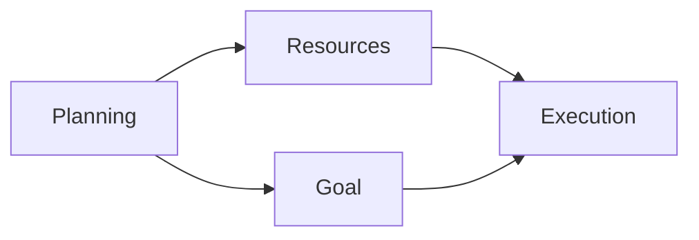

# Markdown
The markup language *Markdown* with its corresponding file format .md has become a standard for plain text documents. Checkout GitHub's documentation for a guide on how to markup a text with their version:

[GitHub flavoured Markdown](https://docs.github.com/en/get-started/writing-on-github/getting-started-with-writing-and-formatting-on-github/basic-writing-and-formatting-syntax)

Markdown helps authors write web articles without HTML. The resulting markup is so minimal that the writing experience is not disturbed and the editorial process can continue while the article is rendered online as a webpage. 

You can use any plain text editor to write in Markdown. You need some tool to preview Markdown. Both Rider and Visual Studio should give you support for both editing and previewing. 

## Create a CV
Translating your present CV into Markdown should provide a good opportunity to try the basic formatting. 

## Create a GitHub profile README
Change the presentation on your GitHub account profile page with a custom README file. See this link for a guide on how to set up the page:

[GitHub profile README](https://docs.github.com/en/account-and-profile/how-tos/profile-customization/managing-your-profile-readme)

You can style the presentation to your preferred taste. Search YouTube for inspiration on how to add specific sections or ask AI for guidance. 

## Use Mermaid
A more advanced project would be to use the diagramming tool Mermaid, which takes care of the visual translation, lets you focus on the data and makes content easy to edit. Check this link for documentation and tutorials on how to use it:

[Mermaid](https://mermaid.js.org/intro/)

Here is an example of a simple graph, using Mermaid:

Mermaid supports developers in the planning stage by capturing logic. Developers can also benefit from Mermaid when documenting solutions. 

Try to describe some process with Mermaid, like following a recipy.